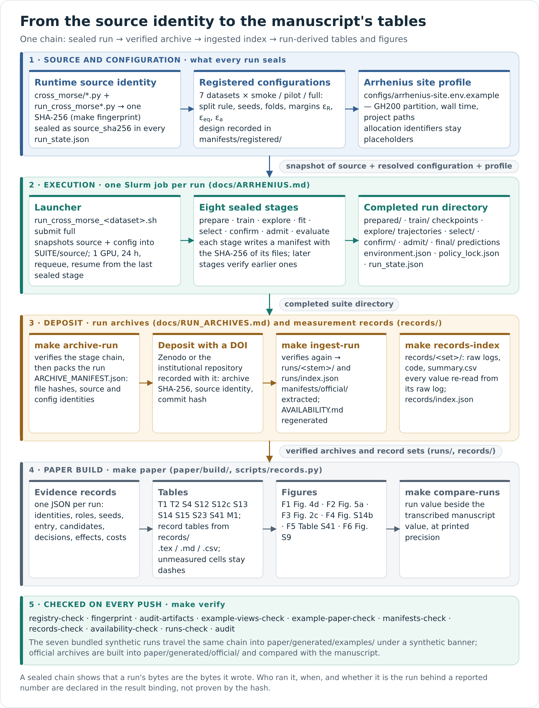
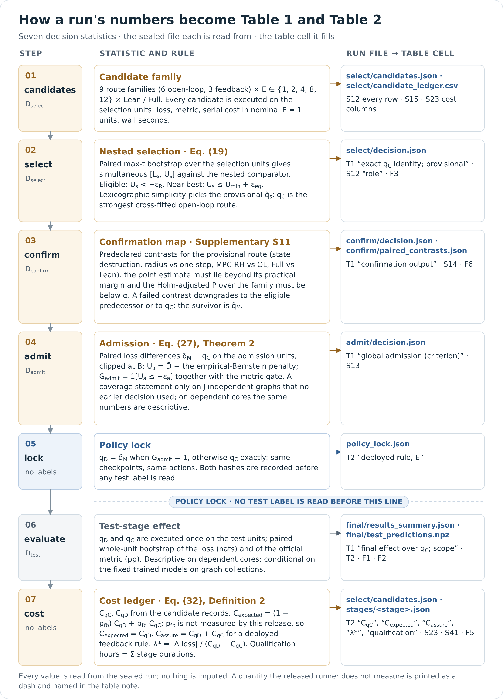

# CROSS-MORSE

**Cross-spectral control of message passing in frozen graph neural networks**

Abdolvahab Khalili Sadaghiani and Jose Nunez-Yanez · Linköping University

[Reviewer guide](docs/REVIEWER_GUIDE.md) · [Availability](AVAILABILITY.md) · [Status](docs/STATUS.md) ·
[Run archives](docs/RUN_ARCHIVES.md) · [Arrhenius](docs/ARRHENIUS.md) · [Method](docs/METHOD_OVERVIEW.md) ·
[Documentation index](docs/README.md)

CROSS-MORSE asks whether further message passing is useful for a particular input, and
whether feedback improves on a well-selected open-loop schedule. An external controller
observes a frozen GNN and chooses registered transport or recovery actions; the predictor's
weights, update functions and prediction head stay fixed. Selection, held-out mechanism
confirmation and admission decide whether feedback is deployed, and rejection returns the
selected comparator exactly.

This repository is our complete research package for the manuscript submitted to
*Scientific Reports*: the implementation, the launchers we use on the Arrhenius cluster, the
environment specifications, seven complete synthetic end-to-end example runs, the scripts that
build the paper's run-derived tables and figures from completed run directories, and the
contract through which the measurements of the supplementary experiments enter with their raw
logs. [`AVAILABILITY.md`](AVAILABILITY.md) names exactly which tables and figures each path
produces; [`paper/KNOWN_DIFFERENCES.md`](paper/KNOWN_DIFFERENCES.md) lists every difference between
the code and the manuscript.

## What is here, item by item

The reviewers asked for experiment code, data, split/seed manifests, an environment
specification, checkpoints, predictions, trajectories, statistical outputs, figure/table
generators and a Makefile that regenerates tables and figures. This table is generated from
the repository state (`make availability`); it says what is present now and what is not.

<!-- availability:start -->
**Code availability.** The complete implementation of CROSS-MORSE (the `cross_morse` package: frozen plants, transport adapter, action registry, sensing, observer, consequence models, the nine policy families, selection, confirmation and admission statistics, and the sealed eight-stage lifecycle), the dataset adapters for the seven benchmarks, one entry point and three configurations per dataset, the Slurm launchers used on the Arrhenius cluster together with its site profile, the environment specifications, the test suite, the scripts that build, from completed run directories, the run-derived columns of main Tables 1–2 and Supplementary Tables S4, S12, S12c, S13–S15, S23 and S41, main Figs. 2c, 4d and 5a, and Supplementary Figs. S9 and S14b (`make tables`, `make figures`), and the scripts that verify and tabulate deposited measurement records (`make records-check`, `make records-tables`) are available in the CROSS-MORSE GitHub repository (https://github.com/VKHS/CROSS-MORSE; runtime source identity 9e0154c11c0e…, printed by `make fingerprint` and sealed into every run record). The tables of the experiments outside the eight-stage run are printed from their deposited measurement records (data statement); their figure panels and the analytical tail-cost model of Supplementary Table S44 have no builder here, and `paper/KNOWN_DIFFERENCES.md` lists every difference between this code and the manuscript.

**Data availability.** All seven datasets are official public releases (OGB, the heterophily benchmark collection and LRGB) obtained from their providers through the repository's adapters; no dataset is redistributed. The registered split rule, seeds, fold structure and margins of every configuration are in `manifests/registered/`, and the role membership hashes, seeds and recorded environment of every completed run are extracted into `manifests/<label>/` by `make manifests`. Verified official-data run archives are registered for 0 of 7 datasets (none); the archives for ogbn-arxiv, ogbn-proteins, ogbn-products, Roman-empire, PascalVOC-SP, COCO-SP, Peptides-func are not yet deposited. Until they are, the numerical results in the manuscript are the authors' reported measurements, transcribed with page provenance in `paper/reported_results.json` for comparison only. The repository contains seven complete synthetic end-to-end example runs with the same artifact types (checkpoints, predictions, trajectories, statistical outputs and stage manifests) under `examples/runs/`, from which `make reproduce` recomputes every decision and `make tables figures` builds the tables and figures named in the code statement; the same commands build them from the official archives once those are ingested with `scripts/ingest_run.py`. Measurement records of the experiments outside the eight-stage run (Supplementary Tables S6c, S15, S15b, S16, S16b, S19, S23, S23b, S25, S26b, S45, S46 and S46b) are deposited under `records/` together with the raw logs every value is read from, for 0 of 10 record sets (none); `make records-tables` prints those tables from them.
<!-- availability:end -->

The paper's own run archives are produced on Arrhenius with the launchers in this repository
and deposited as verifiable archives ([docs/RUN_ARCHIVES.md](docs/RUN_ARCHIVES.md)); the
measurements of the experiments outside the eight-stage run are deposited as record sets
([records/README.md](records/README.md)); [docs/STATUS.md](docs/STATUS.md) lists what is still open.

## Two views of the package

**The evidence chain.** From the runtime source identity through one Slurm job on Arrhenius,
the sealed run directory, the deposit of run archives and measurement-record sets, and the
paper build to the manuscript's tables; the checks of `make verify` run on every push.



**The decision chain.** The seven statistics that turn a completed run into the cells of
Tables 1 and 2: the candidate family, nested selection (Eq. 19), the confirmation map (S11),
admission (Eq. 27), the policy lock, the test-stage effect and the cost ledger, each with the
sealed file it is read from and the table cell it fills.



Both are drawn by `scripts/draw_diagrams.py` from the registered constants and checked in CI
together with the five method diagrams in [`docs/assets/`](docs/assets/README.md).

## Quick start (no dataset download, no training, no GPU)

```bash
# 1. Environment: Python 3.12 with NumPy (Matplotlib for figures). CPU PyTorch only for training/tests.
make env-cpu PYTHON=python3.12 VENV_DIR=../cm_cpu_env        # recorded CPU lock
source ../cm_cpu_env/bin/activate

# 2. Everything CI checks on a fresh clone.
make verify

# 3. Recompute selection, confirmation, admission, scores and intervals from the bundled predictions.
make reproduce REPORT_ROOT=../cm_reports

# 4. Build the paper's tables and figures from run directories.
make example-paper            # from the seven synthetic example runs (committed under paper/generated/examples)
make paper                    # from the official run archives registered in runs/index.json
```

`make verify` runs the release audit, the runtime source fingerprint, the manuscript-registry
arithmetic, the artifact inventories of the seven examples, the example replay, the example
paper build, the manifest checks and the availability check. All of it is NumPy-only.

## How a reviewer can check the chain

| Question | Command | What it establishes |
|---|---|---|
| Is the code the code? | `make fingerprint` | SHA-256 of the runtime source matches the identity sealed into every run |
| Are the bundled runs intact? | `make audit-artifacts` | every file of the seven example runs matches its sealed stage manifest |
| Do the decisions follow from the predictions? | `make reproduce` | selection, confirmation, admission and test effects recomputed from saved predictions and labels |
| Do the tables come from runs? | `make example-paper-check` | committed tables/evidence equal a fresh build from the run directories |
| Which splits, seeds and environment did a run use? | `make manifests-check` | per-run manifests equal a fresh extraction from the sealed records |
| Does the availability statement match the tree? | `make availability-check` | the statement in `AVAILABILITY.md` and in this README is regenerated from the repository state |
| Do run-derived values agree with the manuscript? | `make compare-runs` | agreement levels per quantity against the transcribed registry |
| Is an archive what it says? | `python -B scripts/archive_run.py --verify x.tar.gz` | every file hashed; stage chain re-verified on ingest |
| Which reading of the selection rule did a run follow? | Table S12c (`make example-paper`, `make paper`) | the three equivalence readings of main Eq. (19), the route selected, and the registered rule over all configurations checked against the sealed selection |
| Do the supplementary measurements come from logs? | `make records-check` | every value of every deposited record set re-read from its raw log; files match their manifest |

The ordered reading path is in [docs/REVIEWER_GUIDE.md](docs/REVIEWER_GUIDE.md).

## Running the experiments

Each dataset has a Python entry point, a Slurm wrapper and three configurations: `smoke`
(synthetic data, minutes on a CPU), `pilot` (official data, reduced budget) and `full` (the
registered design). Configurations are in `configs/`; their registered seeds, roles and
margins are extracted into `manifests/registered/`.

```bash
# synthetic end-to-end run on a CPU (needs PyTorch)
python -B run_cross_morse_arxiv.py --profile smoke --device cpu --threads 2 --stage all \
    --data-root ../cm_data --output-dir ../cm_runs/arxiv_smoke

# official data, prepared without training
python -B run_cross_morse_arxiv.py --profile pilot --stage prepare --device cpu \
    --data-root ../cm_data --output-dir ../cm_runs/arxiv_pilot
```

On Arrhenius:

```bash
cp configs/arrhenius-site.env.example configs/arrhenius.env.example   # fill CM_ACCOUNT and CM_STORAGE_PROJECT
bash run_cross_morse_arxiv.sh dry-run full
bash run_cross_morse_arxiv.sh submit setup                             # once per environment
bash run_cross_morse_arxiv.sh submit full
bash run_cross_morse_roman_empire.sh submit campaign full /abs/path/roman_campaign   # ten official splits
```

[docs/ARRHENIUS.md](docs/ARRHENIUS.md) walks through the site profile, the job shape, the
storage layout, resuming and capturing the GPU environment; [docs/HPC.md](docs/HPC.md) is the
generic launcher contract.

## From a finished run to the paper

```bash
make archive-run RUN_ROOT=/abs/outputs/CROSS_MORSE_arxiv_full_... OUTPUT=../deposits/arxiv_full.tar.gz
make ingest-run ARCHIVE=../deposits/arxiv_full.tar.gz DOI=10.5281/zenodo.NNNNNNN
make paper                 # tables, figures and evidence under paper/generated/official
make compare-runs          # agreement with the transcribed manuscript values
make availability          # the statement now names the deposited archive
```

`archive_run.py` verifies the sealed stage chain before packing and writes an
`ARCHIVE_MANIFEST.json` with one SHA-256 per file; `ingest_run.py` re-verifies the chain after
extraction and is the only writer of `runs/index.json`. The Roman-empire campaign is archived
with `make archive-campaign` and aggregated over its ten splits by the evidence extractor.

The supplementary experiments that run outside the eight stages (external baselines, factorials,
negative controls, input gate, nominal timing, executed sensor settings, cross-backbone
substitutions, extended ensemble grid, inserted-site attribution, budget-matched arms) enter as
record sets under [`records/`](records/README.md); `make records-index` traces every value to its
raw log and `make records-tables` prints their tables.

## Repository map

| Location | Contents |
|---|---|
| `cross_morse/` | plants, transport adapter, action registry, sensing, observer, learning, policies, statistics, lifecycle |
| `run_cross_morse*.py`, `run_cross_morse*.sh`, `configs/` | entry points, Slurm launchers, 21 configurations, site profiles |
| `paper/build/`, `scripts/build_paper.py` | evidence extraction and the run-driven table and figure builders |
| `paper/generated/` | committed example build; `official/` once the run archives are ingested |
| `paper/*.json`, `paper/*.md` | values transcribed from the manuscript with page provenance, for comparison only; the manuscript is identified by SHA-256 in `paper/sources.json` |
| `runs/`, `scripts/archive_run.py`, `scripts/ingest_run.py` | run-archive contract, verification and index |
| `manifests/` | registered designs and per-run split/seed/environment manifests |
| `examples/` | seven complete synthetic runs with checkpoints, predictions, trajectories and statistics |
| `records/`, `scripts/records.py` | measurement records of the experiments outside the eight-stage run, traced value by value to their raw logs |
| `environment/` | CPU lock of the validated environment; Arrhenius GPU capture script |
| `docs/` | method, implementation contract, datasets, compute, Arrhenius, run archives, status, validation |
| `tests/`, `.github/workflows/` | unit tests and the CI that runs `make verify` on every push |

## Citation and license

```bibtex
@unpublished{khalili2026crossmorse,
  title  = {CROSS-MORSE: Cross-Spectral Control of Message Passing in Frozen Graph Neural Networks},
  author = {Khalili Sadaghiani, Abdolvahab and Nunez-Yanez, Jose},
  year   = {2026},
  note   = {Manuscript under review. Code: https://github.com/VKHS/CROSS-MORSE}
}
```

Source code is distributed under the [BSD 3-Clause License](LICENSE); see [NOTICE](NOTICE).
[CONTRIBUTING.md](CONTRIBUTING.md) describes how to report a run and propose a change.
Correspondence: abdolvahab.khalili.sadaghiani@liu.se.
