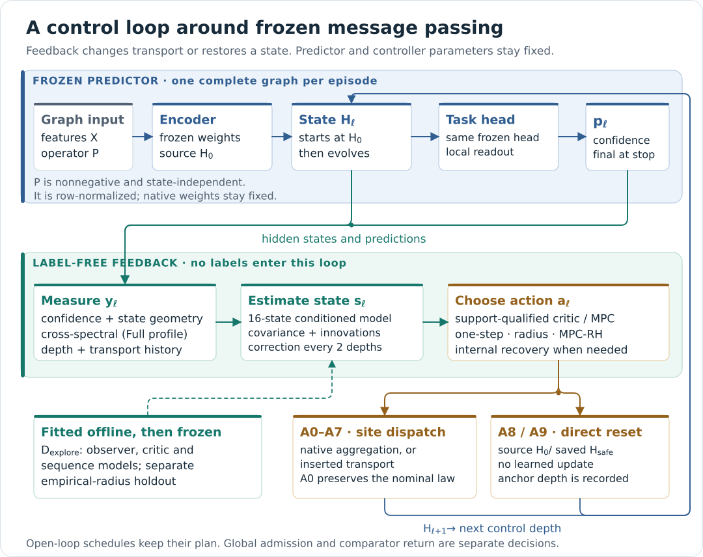
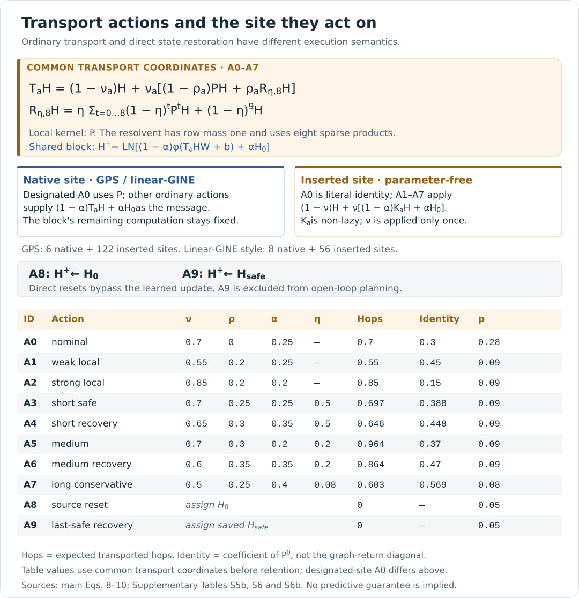
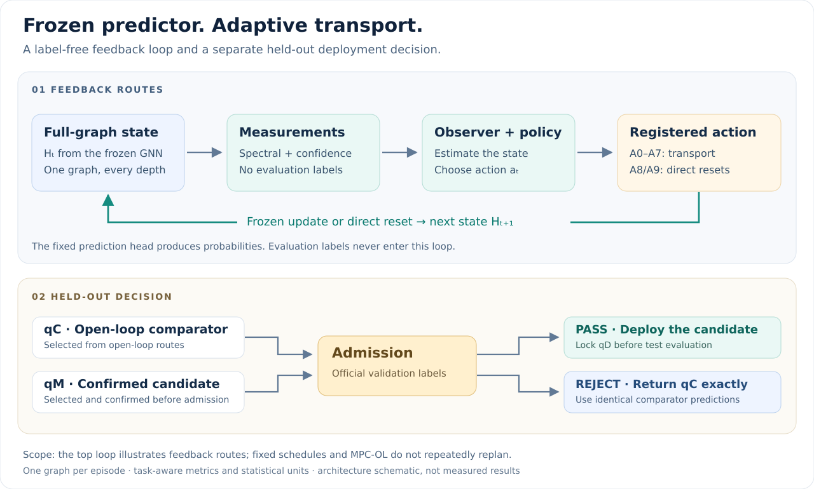
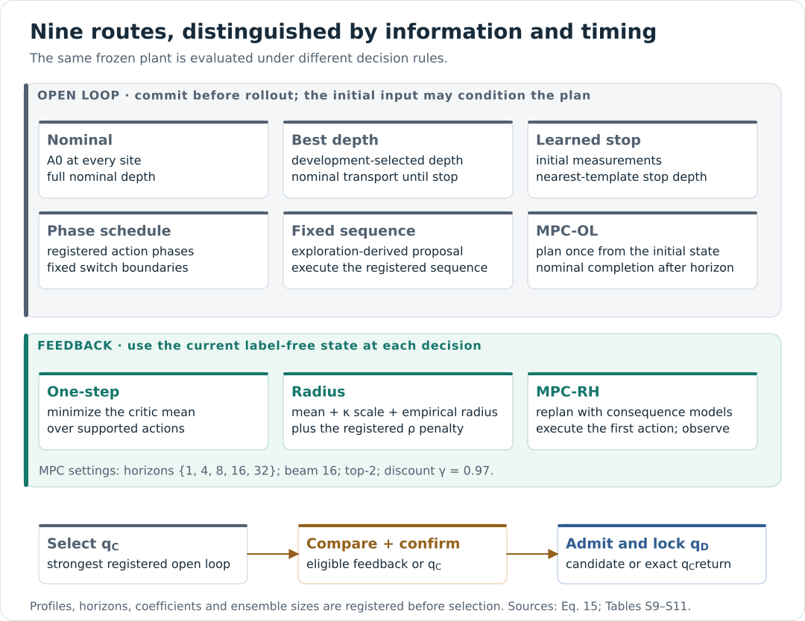
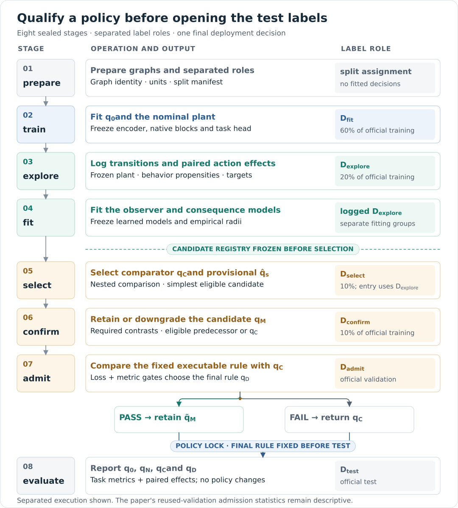

# How CROSS-MORSE works

**CROSS-MORSE controls how a frozen graph neural network transports information as propagation proceeds.** It first asks how much can be gained by choosing a better fixed schedule. It then tests whether observations of the evolving representation justify feedback, uncertainty adjustment or repeated planning.

This page explains the implemented workflow for all seven datasets. Our submitted main manuscript and supplement give the method and our reported measurements. The [manuscript-to-code map](METHOD_MAPPING.md) connects their definitions to source functions; the [implementation contract](IMPLEMENTATION_CONTRACT.md) fixes the executable choices; [theory and scope](THEORY_AND_SCOPE.md) separates algebraic identities, conditional guarantees and empirical evidence. Page references below use the PDFs' printed page numbers.

*The three planes of the implementation: the frozen plant with its transport adapters, the label-free loop that runs at every control depth, and the offline qualification interface where labels enter in separated roles. Generated by `scripts/draw_diagrams.py` from the registry files.*

## 1. The comparison that motivates the method

Each propagation step changes which node information reaches the next representation. A fixed amount of mixing at every depth need not be the best schedule for a trained predictor. A controller can instead vary local mixing, use a truncated resolvent to combine several propagation lengths, or return to a saved reference state.

The scientific comparison has two parts. First, select a strong **open-loop comparator** from policies whose decisions are fixed before the rollout, possibly using the initial input. Then evaluate policies that can use **label-free feedback** during the rollout. This distinguishes the value of a better schedule from the additional value of observing the current state. On a deterministic plant, intermediate states are themselves functions of the input: the question concerns efficient sequential decisions within a declared policy family and budget, rather than access to new external information (main pp. 2–3, Eqs. 1–3).

The execution episode depends on the dataset. Within an episode, each frozen checkpoint executes one action at each control depth. Features and edges are available to the predictor; labels have separate development and evaluation roles.

| Datasets | Complete execution episode | Prediction task | Benchmark metric |
|---|---|---|---|
| ogbn-arxiv, ogbn-products, Roman-empire | One transductive graph | Multiclass node labels | Accuracy |
| ogbn-proteins | One transductive graph | Multilabel node labels | ROC-AUC |
| PascalVOC-SP, COCO-SP | One independent graph | Multiclass node labels | Macro F1 |
| Peptides-func | One independent graph | Multilabel graph labels | Average precision |

For the four single-graph datasets, cores summarize losses and supply dependent resampling units. They do not receive separate controllers or replace the graph with isolated subgraphs. For the three independent-graph datasets, each graph starts a fresh control episode; attention, readout pooling, sensors, observer state and reset anchors never mix examples. Roman-empire's ten official masks define ten separate runs on the same graph. See the contract's [execution-unit specification](IMPLEMENTATION_CONTRACT.md#frozen-predictor-and-execution-unit).

## 2. What is fixed, and what is learned?

The implementation separates predictor training, controller development and policy evaluation.

| Component | How it is obtained | During a policy rollout |
|---|---|---|
| Encoder, propagation blocks, normalization, attention and head | Train the dataset's nominal plant on `Dfit`, with internal checkpoint selection | All parameters are frozen; the same head reads the current representation |
| Source representation `H0` | Apply the frozen encoder to graph features | Retained for registered source-retention operations and A8 |
| Measurement map | Fixed confidence, geometry, history and spectral definitions | Evaluated without labels |
| Observer and consequence models | Fit on model-fitting groups within `Dexplore` | Parameters stay fixed; the estimated state evolves |
| Empirical action radii | Fit after model freezing on separate `Dexplore` groups | Read by the registered scoring rule |
| Policy configuration | Register route, profile, horizon, coefficients and ensemble size before selection | Executes its declared rule |
| Last-safe reference | Initialize at `H0`; update with the shared label-free predicate | Feedback may save or restore a state; no parameter learning occurs |

Arxiv and products use a shared learned propagation update; proteins uses its edge-weighted variant. Roman-empire has separate ego and neighbor maps. The superpixel tasks use six GPS-style blocks with graph-local attention, and peptides uses eight linear-aggregation GINE-style blocks with graph mean readout. Their control depths include the registered native and inserted sites. Each run emits its actual tensor inventory; full-profile dimensions, site placement and architecture choices are specified in the [contract](IMPLEMENTATION_CONTRACT.md#frozen-predictor-and-execution-unit).

The paper's supported interface requires readable hidden states and a **nonnegative, state-independent linear aggregation operator** that can be row-normalized, with the surrounding native update and head held fixed. This excludes a controlled state-dependent attention kernel or a standard nonlinear edge-message GINE operator. GPS's global-attention branch keeps its computation and parameters; changing its incoming states can still change its activations. The repository constructs explicit supported plants rather than providing a universal third-party hook adapter (main p. 4, Definition 1; supplement pp. 3–4, Tables S5–S5c).

### Four predictors to keep distinct

| Symbol | Role in this implementation | Question it helps answer |
|---|---|---|
| `q0` | Separately trained encoder/head reference, without propagation | Does the nominal plant meet the training-only entry criteria? |
| `qN` | Frozen plant executing A0 to its full registered depth | What does native nominal transport do? |
| `qC` | Open-loop comparator selected by nested development comparisons | What can the registered open-loop family achieve? |
| `qD` | Final retained policy, or exact cached `qC` output | Which predictor does the completed experiment deploy? |

The intermediate provisional candidate is `q̂s`, the confirmed candidate is `qM`, and `q̃M` denotes its executable form with declared input compatibility and internal recovery. The global admission decision chooses between this executable rule and `qC`. The repository checks the prepared benchmark identity; a general input gate for novel serving inputs is outside its runtime. Improvement over `q0` or `qN` answers a different question from improvement over `qC`. The final policy decision precedes test-label access (main p. 3, Eqs. 3–4).

## 3. The transport action

Let `H` contain current node representations, `H0` be the encoded source, and `P` be the row-stochastic graph operator, including the configured nonnegative edge weights. The registered transport primitive is

$$
T_a H=(1-\nu_a)H+\nu_a\big[(1-\rho_a)PH+\rho_a K_aH\big],
$$

For the shared propagation plants used by arxiv, products and proteins, ordinary actions A0–A7 then apply

$$
H^+=\operatorname{LN}\!\left((1-\alpha_a)\,\phi(T_aHW+b)+\alpha_aH_0\right).
$$

Here `W`, `b`, the activation and LayerNorm belong to the frozen plant. An action changes the mixing amount `nu`, resolvent mixture `rho`, and source retention `alpha`. For local actions, `K_a = P`. For resolvent actions,

$$
K_aH=\eta_a\sum_{t=0}^{T}(1-\eta_a)^tP^tH+(1-\eta_a)^{T+1}H.
$$

The final identity term retains the omitted probability mass. With `T = 8`, the kernel uses eight sparse graph products, reusing the first product in the mixture. It requires neither a dense graph inverse nor a dense node-by-node matrix (main p. 4, Eqs. 8–9). The [action registry](METHOD_MAPPING.md#2-action-registry) gives each action's parameters and executed range. A resolvent's truncation order, expected transported hops and identity coefficient are different quantities: for example, A7 has maximum polynomial degree eight but only about 0.603 expected transported hops per application in the common coordinates (supplement p. 5, Table S6b).

*Left: the five steps of Algorithm S2 at every control depth. Right: the transport primitive and the registry of Tables S6/S6b, with each action's executed range and identity coefficient read from `paper/registered_constants.json`.*

The surrounding frozen update is backbone-specific. Roman-empire combines separate ego and transported-neighbor maps. At a GPS or linear-GINE native site, nonzero transport actions replace the local aggregation input while retaining that block's remaining computation. At an inserted site, A0 is a **literal identity**; A1–A7 apply parameter-free transport and source retention, with the lazy mixing coefficient used once. GPS has **6 native plus 122 inserted sites**, and Peptides has **8 native plus 56 inserted sites**. Their full control depths therefore do not mean 128 or 64 learned native layers. The [native and inserted site contract](IMPLEMENTATION_CONTRACT.md#native-and-inserted-sites) specifies the exact dispatch.

| Actions | Operation |
|---|---|
| A0 | Native nominal block at a native site; identity at an inserted site |
| A1–A2 | Alternative local mixing/retention settings |
| A3–A7 | Registered resolvent mixtures with different kernel and retention settings |
| A8 | Assign `H0` directly |
| A9 | Assign the saved last-safe representation directly |

A8/A9 bypass the learned update and LayerNorm. *Last-safe* names an execution convention: finite measurements with normalized entropy at most 0.99. Exploration and feedback use the same predicate; it does not certify predictive correctness. Open-loop schedules use A8. A9 belongs to feedback or diagnostic replay with recorded anchor depths. See [actions and reference states](IMPLEMENTATION_CONTRACT.md#actions-and-reference-states).

## 4. The feedback loop

The diagram shows the feedback routes and the separate held-out decision. Fixed schedules use the same frozen plant but choose their action sequence before execution.

Each episode initializes `H0`, the source measurement reference, observer and reset anchor independently. Each subsequent depth:

1. Measures the current representation and frozen-head predictions.
2. Advances the observer using the previous action, with measurement correction on its registered cadence.
3. Determines supported actions from the current depth/entropy cell and updates the saved reference using the shared predicate.
4. Chooses an action, or uses internal recovery when support, observer validity or the planning-call budget prevents an ordinary choice.
5. Executes the action and records its origin, supported set, reset anchor and work.

Internal recovery chooses A0 when supported, otherwise the saved-reference reset for feedback. This event is distinct from the later experiment-wide decision to return `qC`. The dispatch is in [`execute_policy`](../cross_morse/policies.py), and the anchor rule is in [`recovery.py`](../cross_morse/recovery.py).

### Measurements, state and support

The measurement bank has 25 coordinates. Nine summarize confidence, source disagreement, effective rank, Dirichlet energy, depth, cumulative transport and state energy. Sixteen describe retained spectral power, source alignment, degree-weighted power and action reachability. Band power describes the distribution of energy across the retained graph-frequency bands; source alignment tracks similarity to `H0` within each band. These coordinates let feedback respond to representation changes that confidence alone does not describe.

Multiclass confidence uses categorical predictions; multilabel confidence uses binary entropy, threshold margins and binary source divergence. For graph predictions, confidence is measured on graph outputs while hidden-state geometry is measured on the nodes of that same graph.

For a window `G_b` on the symmetric normalized Laplacian, the principal spectral coordinates are

$$
p_{\ell b}=\frac{\|G_bH_\ell\|_F^2}{\sum_{b'}\|G_{b'}H_\ell\|_F^2+\varepsilon},\qquad
c_{\ell b}=\frac{\langle G_bH_\ell,G_bH_0\rangle_F}{\|G_bH_\ell\|_F\|G_bH_0\|_F+\varepsilon}.
$$

The implementation retains three fixed windows from six equal graph-frequency intervals and shares a degree-eight Chebyshev recurrence across windows. It also filters `D^(1/2)H` for the row-stochastic transport descriptors. Reachability compares each A1–A7 transport with the **next site's actual nominal transport**: `0.3I+0.7P` in a shared block, `P` at a designated native block, and `I` at an inserted site. These coordinates indicate potential transport displacement; they do not predict its sign in task loss or certify the complete nonlinear update (main p. 5, Eq. 11; p. 8, Proposition 6).

Full retains these coordinates; Lean zeroes the 16 spectral/reachability coordinates and fits its own controller. An unsketched Full acquisition uses two eight-product filter passes plus one Dirichlet product. Observer correction every two depths does **not** skip sensor acquisition. The executed sensing choices and their cost implications are specified in the [contract](IMPLEMENTATION_CONTRACT.md#measurements-and-observer).

The observer applies fitting-group median/MAD normalization and PCA, then depth/action-conditioned dynamics with covariance and innovation diagnostics. Defaults use a 16-dimensional state, a rank-four-plus-diagonal covariance representation and measurement correction every two depths. Observer consistency is separate from critic uncertainty.

Support uses logged behavior propensities and complete holdout groups: a seed/trajectory pair for a single graph, or one complete graph across all its trajectories and seeds for independent-graph data. Our full profiles require propensity at least 0.05, effective sample size at least 64 and maximum normalized weight at most 0.20. ESS and maximum weight use the same cell-wise weight vector. Unknown or insufficiently supported cells remain unsupported. Estimation choices are specified in the contract's [measurement](IMPLEMENTATION_CONTRACT.md#measurements-and-observer) and [calibration](IMPLEMENTATION_CONTRACT.md#calibration-and-assessment) sections.

## 5. What the learned models predict

Exploration logs actual frozen-plant transitions and paired counterfactual continuations. The critic target is

$$
\Delta_h(H,a)=\ell\!\left(a\ \text{then nominal for }h-1\text{ steps}\right)
-\ell\!\left(\text{nominal for }h\text{ steps}\right),
$$

with both branches starting from the same state and using the same permitted `Dexplore` labels. A0 has an exactly zero paired target. The full profile sets `h = 1` (main p. 5, Eq. 13). This target differs from the complete-policy effect against the selected `qC` in Eq. 14; the comparator-relative advantage of Proposition 11 is a separate theoretical estimand.

| Model | Learned quantity | Runtime use |
|---|---|---|
| Action critic | Mean and scale of the nominal-relative paired effect | One-step/radius choices and MPC action shortlisting |
| Latent transition | Change in estimated latent state after an action | Simulated MPC continuation |
| Stage-cost model | Task-loss change across one executed step | Incremental planning cost |
| Terminal-value model | Remaining nominal-suffix task-loss change | Value of nominally completing a simulated prefix |

Task loss is cross-entropy for multiclass labels and masked binary cross-entropy for multilabel labels. Graph datasets score complete graph episodes; fully unlabelled samples are excluded from loss observations.

For supported actions with a valid observer, **one-step** minimizes the predicted mean. **Radius** minimizes the shared score

$$
\widehat\mu(s,a)+\kappa\widehat\sigma(s,a)
+r(s,a)+\lambda_\rho\rho_a.
$$

The residual radius `r` is fitted after model freezing. Complete `Dexplore` groups are divided approximately 60/20/20 between model fitting, radius fitting and assessment. All trajectories and seeds belonging to one independent graph stay in the same partition. Sequential filtering still resets on each trajectory, and cross-fitting stays within the model-fitting partition using the same group boundaries. Calibration uses group maxima of absolute residuals, with action-pooled fallback for sparse cells. Assessment uses separate groups and the same scoring function as runtime.

MPC uses its separate transition, stage and terminal models to compare simulated sequences, including declared uncertainty and transport costs. The full configuration uses discount `0.97`, horizons in `{1, 4, 8, 16, 32}`, beam width `16` and two shortlisted actions per expanded state. Beam search is approximate. A complete-policy guarantee does not follow from adding action-critic predictions, and per-action calibration does not establish simultaneous sequence accuracy (main p. 5, Eq. 17; p. 8, Proposition 8). Calibration assessment concerns logged-history states; its empirical scope is documented in the [contract](IMPLEMENTATION_CONTRACT.md#calibration-and-assessment).

## 6. Nine routes, with distinct information contracts

| Route | Decision information | Decision timing |
|---|---|---|
| Nominal | Registered A0 | Fixed entire rollout |
| Best depth | Development comparison over registered depths | Depth chosen before execution |
| Learned stop | Initial measurements and nearest-template stopping predictor | Choose depth once at initialization |
| Phase schedule | Registered action pairs and switch boundaries | Entire schedule fixed in advance |
| Fixed sequence | Complete exploration-derived sequence proposal | Entire schedule fixed in advance |
| MPC-OL | Initial estimated state and consequence models | Plan once; nominal tail after the planned horizon |
| One-step | Current estimated state and critic mean | Choose an action at each depth |
| Radius | Current state, critic scale, radius and transport penalty | Choose an action at each depth |
| MPC-RH | Current state/history and sequence models | Replan; execute the first action |

Profiles, horizons, radius coefficients and retained ensemble sizes generate the finite candidate registry, saved before `Dselect`. Static schedules receive support audits, but observations cannot revise their plans. MPC-OL excludes dynamic-anchor A9 at every planning query; feedback retains it. Exact feedback replay saves action IDs and anchor depths.

The initial-template stopping rule, schedule proposal ranking and compressed A9 consequence state are specified in the [policy-family contract](IMPLEMENTATION_CONTRACT.md#policy-family-and-target-qualification). These implemented definitions determine how their comparisons should be interpreted.

## 7. From training to a retained predictor

| Command stage | Label role | Main result |
|---|---|---|
| `prepare` | Prepare graphs and label-role assignments | Graph/split identity, core or graph-unit metadata and actions |
| `train` | `Dfit` | Separate `q0` and plant checkpoints; freeze identities |
| `explore` | `Dexplore` | Trajectories, propensities and paired targets |
| `fit` | Previously logged `Dexplore` targets | Controllers, radii, assessment and frozen registry |
| `select` | `Dexplore` entry diagnostics, then `Dselect` | Comparator `qC`, eligible set and provisional policy |
| `confirm` | `Dconfirm` | Mechanism contrasts and confirmed/downgraded `qM` |
| `admit` | Official validation, `Dadmit` | Locked comparison; choose `qD = qM` or `qD = qC` |
| `evaluate` | Official test, `Dtest` | Metrics for the already locked predictors |

The official training portion is allocated 60/20/10/10 to `Dfit`, `Dexplore`, `Dselect` and `Dconfirm`, with an internal checkpoint-validation subset inside `Dfit`. For independent-graph datasets these roles contain whole graphs, including all their node labels where applicable. Calibration's 60/20/20 group split is a subdivision **inside `Dexplore`**. The command `fit` means controller fitting; predictor fitting occurs in `train`.

Selection reconstructs the open-loop comparator inside nested resampling, then applies the registered simultaneous upper-limit rule and deterministic simplicity ordering. Confirmation tests whether the additional information or policy component supports retaining its complexity; missing required comparisons cannot pass. Macro F1, ROC-AUC and AP are recomputed from saved probability observations in each resample, including the reconstructed comparator predictions, because these metrics are not averages of per-node metric values.

For the four single-graph datasets, admission makes a descriptive paired comparison on dependent cores. For the three independent-graph datasets, it computes the clipped empirical-Bernstein upper limit with equal graph weights, plus the configured improvement and metric gates. Its finite-sample interpretation requires independent target-distribution admission graphs and policies fixed without those observations. The paper explicitly states that its **reported** multi-graph confirmation and admission reused validation, so those reported limits remain descriptive; the separated executable lifecycle does not retrospectively repair that reuse (main pp. 6–7, Theorem 2; supplement p. 31, Note S26). Rejection returns the locked comparator's exact cached prediction bytes. These decisions are implemented in [`statistics.py`](../cross_morse/statistics.py), [`evaluation.py`](../cross_morse/evaluation.py) and [`pipeline.py`](../cross_morse/pipeline.py).

Roman-empire's campaign runs all ten official masks and summarizes paired split effects with a descriptive Student-t interval. The masks overlap on one graph; the summary neither treats them as ten independent graphs nor changes the sealed decisions of the individual runs. The [run guide](GETTING_STARTED.md#5-run-roman-empire-splits) gives the campaign commands.

## 8. Reading the evidence

A result should identify its source, resolved configuration, checkpoints, candidate registry and decision artifacts. The repository supports three complementary checks: recompute statistics from saved numeric observations, reexecute trusted frozen checkpoints, and repeat the full experiment in a new run. The [reviewer guide](REVIEWER_GUIDE.md) explains those paths.

This implementation covers all seven dataset adapters, their task metrics, the declared frozen backbones and the registered core policy family. The source package does not include the original result-producing checkpoints or complete official benchmark runs. The [implementation contract](IMPLEMENTATION_CONTRACT.md) collects the architecture, sensor, oracle and statistical choices; [`paper/KNOWN_DIFFERENCES.md`](../paper/KNOWN_DIFFERENCES.md) records material departures; [validation](VALIDATION.md) records execution evidence. The paper's additional initial-input predictor, distillation, no-observation replanning and optional budget-aware rule are distinct experiments outside the nine-route runtime. Reported measurements, derived calculations and new run observations have separate provenance; [RESULTS.md](RESULTS.md) explains how to read them.
